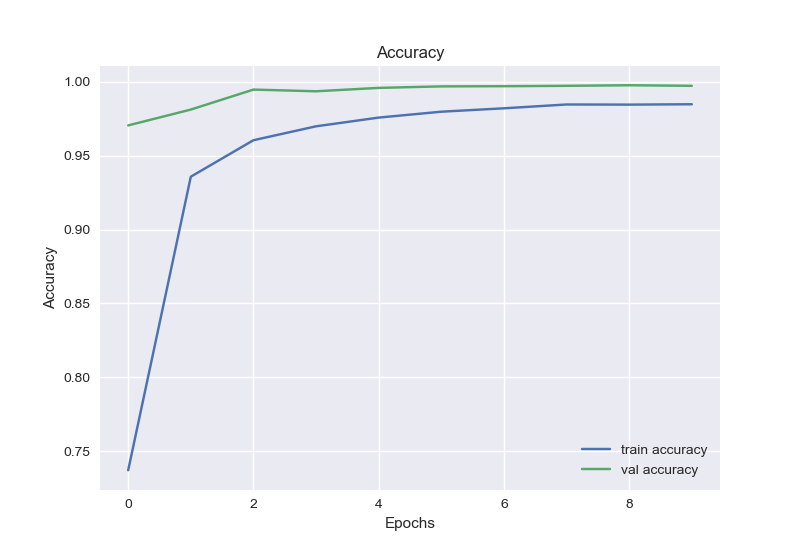
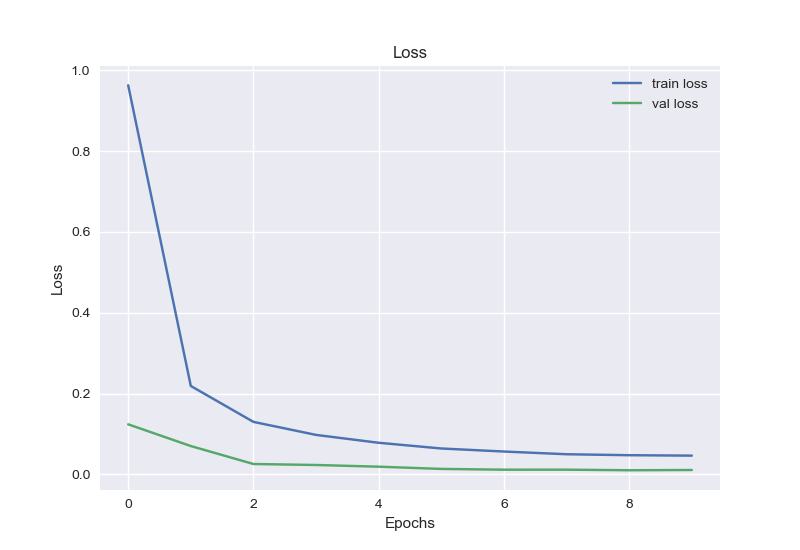

<div align="center">
  

  <br />

  [](https://www.python.org/)
  [](https://www.tensorflow.org/)
  [](https://opencv.org/)
  [](#model-at-a-glance)

  A learning project that trains a convolutional neural network to classify
  traffic-sign images and exposes the trained model through a small desktop GUI.
</div>

## What I built

This repository documents an end-to-end image-classification experiment:

- preparing train, validation, and test arrays from labelled traffic-sign images;
- building and training a CNN with TensorFlow/Keras;
- evaluating the saved model and recording its test score;
- plotting accuracy and loss across training epochs; and
- classifying a user-selected image in a Tkinter desktop interface.

The committed experiment records a **98.01% test accuracy** in
[`reports/scores.csv`](reports/scores.csv). This is a historical result from the
saved experiment, not a newly reproduced benchmark.

## Results

<table>
  <tr>
    <td align="center"><strong>Training and validation accuracy</strong></td>
    <td align="center"><strong>Training and validation loss</strong></td>
  </tr>
  <tr>
    <td></td>
    <td></td>
  </tr>
</table>

## Model at a glance

| Stage | Implementation |
| --- | --- |
| Input | RGB image resized to `64 × 64` |
| Feature extraction | Three `Conv2D → BatchNorm → ReLU → MaxPool → Dropout` blocks |
| Classifier | `Flatten → Dense(128) → BatchNorm → ReLU → Dropout` |
| Output | 43-class softmax |
| Training | Adam optimizer, categorical cross-entropy, 10 epochs by default |
| Interface | Tkinter image picker and predicted class label |

## Project flow

```text
labelled images
      │
      ▼
data preparation ──► NumPy train / validation / test arrays
      │
      ▼
CNN training ──────► saved Keras model + training history
      │
      ├────────────► evaluation score and plots
      │
      ▼
Tkinter GUI ───────► traffic-sign class prediction
```

## Repository structure

```text
.
├── main.py                       # Original experiment entry point
├── src/
│   ├── data/prep_data.py         # Dataset loading and NumPy export
│   ├── model/model.py             # CNN architecture and training
│   ├── model/test_model.py        # Model evaluation and score logging
│   ├── model/predict_model.py     # Single-image prediction
│   └── gui_app.py                 # Tkinter desktop interface
├── visualization/visualizon.py   # Accuracy, loss, and score plots
└── reports/                        # Saved experiment results
```

## Running the original prototype

Install the Python dependencies:

```bash
python -m venv .venv
source .venv/bin/activate          # Windows: .venv\Scripts\activate
pip install -r requirements.txt
```

The repository contains the source code and historical plots, but it does not
contain the training dataset or the saved `.h5` model. Before running the
pipeline, provide those artifacts and replace the original machine-specific
Windows paths in the Python files with paths on your system.

The original implementation also uses the removed Keras
`predict_classes` API. With a current TensorFlow release, replace it with
`numpy.argmax(model.predict(image), axis=1)` before launching the GUI.

## Scope clarification

Despite the repository's original name, the committed code performs
**classification**, not object detection: it predicts one of 43 classes for a
cropped traffic-sign image. It does not currently load YOLO weights, generate
bounding boxes, or run detection on a full road scene.

The following YOLOv3 materials were part of the wider learning and research
process, but are separate from the CNN implementation in this repository:

- [YOLO v3 with OpenCV — Kaggle notebook](https://www.kaggle.com/code/valentynsichkar/yolo-v3-with-opencv)
- [Traffic Signs dataset in YOLO v3 format](https://github.com/sichkar-valentyn/Traffic-Signs-dataset-in-YOLO-v3-format)
- [My Kaggle profile](https://www.kaggle.com/emirgney)

The GUI interaction pattern and 43-class label map are based on the
[DataFlair traffic-sign recognition tutorial](https://data-flair.training/blogs/python-project-traffic-signs-recognition/).

## Possible next steps

- replace hard-coded paths with a portable configuration or CLI;
- migrate deprecated Keras calls to current TensorFlow APIs;
- include a reproducible dataset setup and model download workflow;
- add a confusion matrix and per-class metrics; and
- create a separate YOLO-based detector for full-scene localization.

---

Built by [Emirhan Güney](https://github.com/emirguney) as a computer-vision
learning project.
